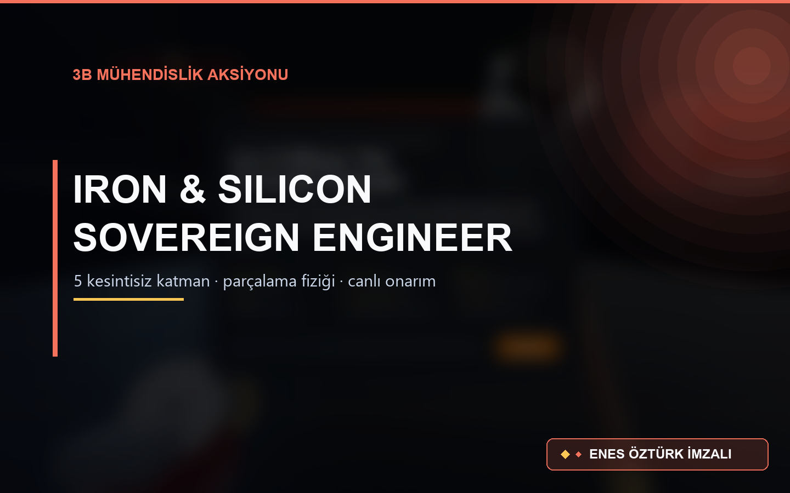
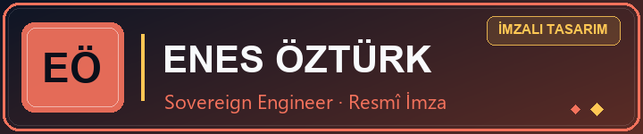
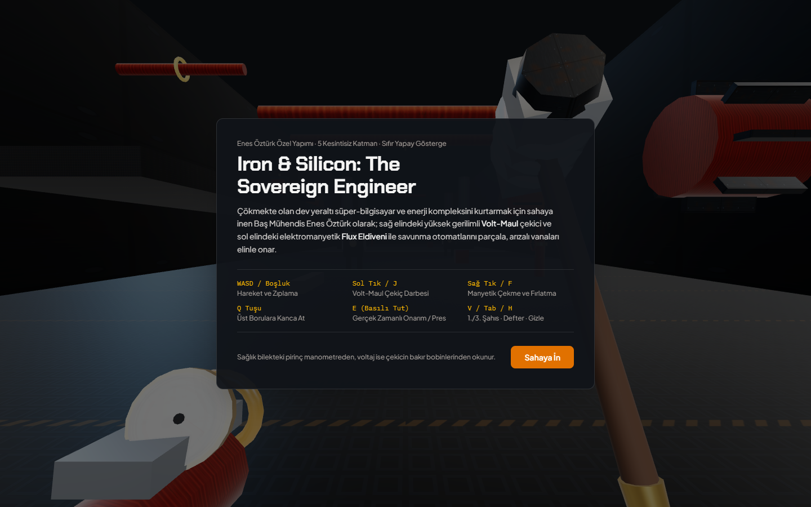
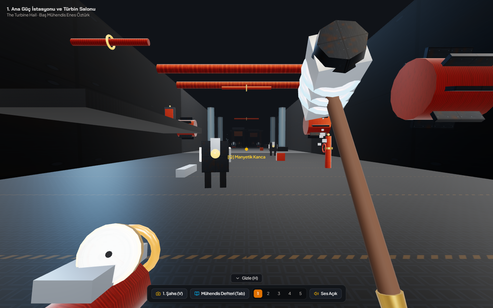
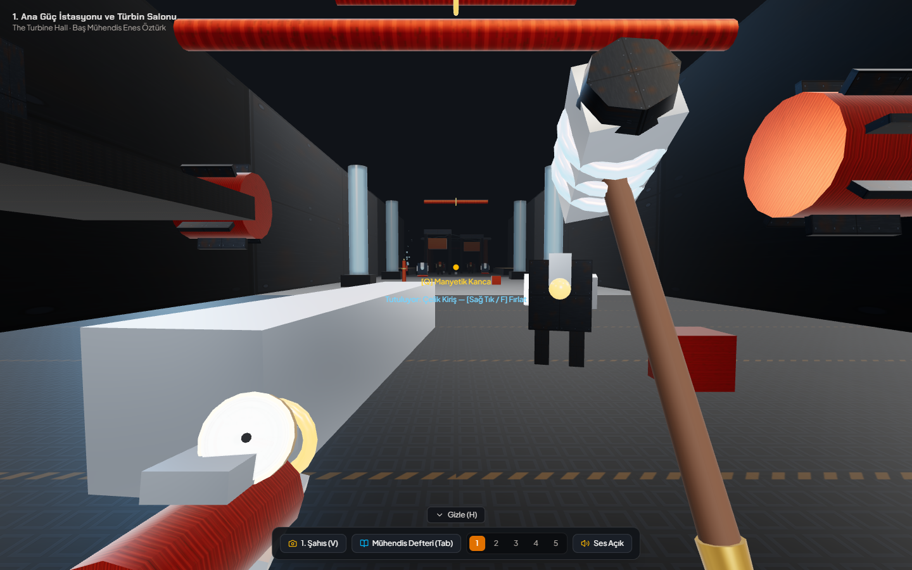

<div align="center">



# Iron & Silicon: The Sovereign Engineer

**Enes Öztürk özel yapımı; mekanik parçalama fiziği ve gerçek zamanlı donanım onarımıyla 3D siber-endüstriyel mühendislik aksiyonu.**

[](https://github.com/EnesBinMalik/iron-and-silicon-sovereign-engineer)
[](https://react.dev/)
[](https://www.typescriptlang.org/)
[](https://threejs.org/)
[](https://vite.dev/)

[](https://github.com/EnesBinMalik)
[](https://github.com/EnesBinMalik/iron-and-silicon-sovereign-engineer)
[](https://github.com/EnesBinMalik/iron-and-silicon-sovereign-engineer)
[](https://github.com/EnesBinMalik/iron-and-silicon-sovereign-engineer)



</div>

---

## Hakkında

**Iron & Silicon**, çökmekte olan dev bir yeraltı süper-bilgisayar ve enerji kompleksinde geçer. Baş Mühendis Enes Öztürk olarak sağ elinizdeki yüksek gerilimli Volt-Maul çekiç ve sol elinizdeki elektromanyetik Flux Eldiveni ile savunma otomatlarını parçalar, arızalı vanaları elinizle onarırsınız.

Beş kesintisiz katman boyunca türbin salonundan Çekirdek Komuta Merkezi'ne inersiniz. Sağlık bilgisi bilekteki pirinç manometrede, voltaj ise çekicin bakır bobinlerinde okunur; yapay gösterge yoktur. Fizik, modeller, dokular ve ses sistemi sıfırdan **Three.js** ile yazılmıştır.

> Bu proje **Enes Öztürk** tarafından tasarlanmış, geliştirilmiş ve imzalanmıştır.

---

## Öne çıkan özellikler

| Özellik | Açıklama |
| --- | --- |
| **5 kesintisiz katman** | Türbin Salonu'ndan Sovereign Core'a kesintisiz dikey iniş. |
| **Volt-Maul çekiç** | `Sol tık` veya `J` ile yüksek gerilimli parçalama darbesi. |
| **Flux Eldiveni** | `Sağ tık` veya `F` ile çelik kirişleri çekip fırlatma. |
| **Manyetik kanca** | `Q` ile üst borulara tutunup yükseklik kazanma. |
| **Gerçek zamanlı onarım** | `E` tuşunu basılı tutarak vana ve panelleri onarma. |
| **Mühendis Defteri** | `Tab` ile katman, görev ve onarım kayıtlarını görme. |
| **Diegetik telemetri** | Sağlık bilekte, voltaj bakır bobinlerde; yapay HUD yok. |
| **1./3. şahıs geçişi** | `V` ile kamera modunu değiştirme. |

---

## Katmanlar

| # | Katman | İngilizce ad |
| --- | --- | --- |
| 01 | Ana Güç İstasyonu ve Türbin Salonu | The Turbine Hall |
| 02 | Soğutma Kuleleri ve Kriyojenik Mahzen | The Cryo-Vaults |
| 03 | Silikon ve Devre Dökümhanesi | The Silicon Foundry |
| 04 | Yüksek Voltaj İletim Köprüleri | The Tesla Viaduct |
| 05 | Çekirdek Komuta Merkezi | The Sovereign Core |

Her bölge kendi fizik kuralları, ışıklandırması, dokusu ve akustik karakteriyle ayrı bir deneyim sunar.

---

## Kontroller

| Tuş | Aksiyon |
| --- | --- |
| `W` `A` `S` `D` / `Boşluk` | Hareket ve zıplama |
| `Sol tık` / `J` | Volt-Maul çekiç darbesi |
| `Sağ tık` / `F` | Manyetik çekme ve fırlatma |
| `Q` | Üst borulara kanca atma |
| `E` (basılı tut) | Gerçek zamanlı onarım / pres |
| `V` | 1. / 3. şahıs geçişi |
| `Tab` | Mühendis Defteri |
| `H` | Arayüzü gizle |

> Savaş sırasında arayüz tamamen kaldırılabilir: ekranda yalnızca dünya içi telemetri kalır.

---

## Galeri







---

## Kurulum

**Gereksinimler:** Node.js 20+ ve modern bir WebGL tarayıcı.

```bash
git clone https://github.com/EnesBinMalik/iron-and-silicon-sovereign-engineer.git
cd iron-and-silicon-sovereign-engineer
npm install
npm run dev
```

Uygulama varsayılan olarak `http://localhost:3000` adresinde açılır.

> Oyun tamamen istemci tarafında çalışır; `.env.example` yalnızca AI Studio dağıtım şablonu içindir.

Diğer komutlar:

```bash
npm run build     # Üretim derlemesi (dist/)
npm run preview   # Derlemeyi yerelde önizle
npm run lint      # TypeScript tip kontrolü
```

---

## Teknik mimari

```text
src/game/engine.ts        Oyun döngüsü, fizik ve çatışma
src/game/world.ts         5 katman ve onarım istasyonları
src/game/models.ts         Çekiç, eldiven ve otomat modelleri
src/game/textures.ts       Endüstriyel prosedürel dokular
src/game/audio.ts          Voltaj ve mekanik ses motoru
src/components/ControlDock.tsx  Katman ve sistem kontrolleri
src/components/EngineerNotebook.tsx  Mühendis Defteri
```

---

## İmza

<div align="center">

[](https://github.com/EnesBinMalik)
[](https://github.com/EnesBinMalik)

**Bu kod, tasarım ve deneyim Enes Öztürk'ün kişisel imzasını taşır.**

© 2026 Enes Öztürk — Tüm hakları saklıdır.

</div>
